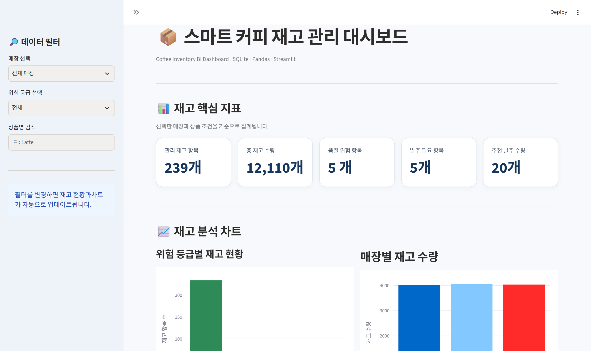

# 📦 스마트 커피 재고 관리 시스템

Python, Pandas, SQLite, Streamlit, Plotly 기반의 **학습용 커피 매장 재고 관리 대시보드**입니다.

> **안내:** 재고 수량과 발주량은 학습용 시뮬레이션 데이터입니다. 실제 매장 운영 데이터가 아닙니다.

## 📷 대시보드 미리보기

최종 화면 캡처 후 아래 경로에 이미지를 저장하세요.



## 🎯 프로젝트 목표

- 매장별 재고와 상품 현황을 한 화면에서 조회
- 재고 위험 등급과 품절 예상일을 바탕으로 위험 상품 파악
- 자동 발주 추천 수량 확인
- 입고·출고 처리와 이력 조회
- 필터 적용 결과를 CSV로 다운로드

## 🛠 기술 스택

| 영역 | 사용 기술 |
|---|---|
| 데이터 처리 | Python, Pandas |
| 데이터베이스 | SQLite |
| 웹 대시보드 | Streamlit |
| 시각화 | Plotly |
| 버전 관리 | Git, GitHub |

## ✨ 주요 기능

1. **재고 KPI:** 관리 항목 수, 총 재고, 위험 항목, 발주 필요 항목, 추천 발주 수량
2. **분석 차트:** 위험 등급별 항목 수, 매장별 재고 수량
3. **검색 및 필터:** 매장, 위험 등급, 상품명
4. **재고 입출고:** 매장·상품 선택 후 입고 또는 출고 처리
5. **이력 조회:** 입출고 내역 확인 및 CSV 다운로드
6. **데이터 내보내기:** 재고 현황과 발주 추천 결과 CSV 다운로드

## 🚀 로컬 실행

Windows CMD 기준으로 프로젝트 폴더에서 실행합니다.

```bat
python -m venv venv
venv\Scripts\activate
pip install -r requirements.txt
python -m streamlit run app.py
```

브라우저에서 `http://localhost:8501`에 접속합니다.

**주의:** `requirements.txt`와 SQLite 초기 데이터 생성 방법은 저장소의 실제 파일 구성에 맞춰 확인해야 합니다. 데이터베이스(`*.db`)는 GitHub에 업로드하지 않는 것이 좋으며, 새 환경에서는 DB 초기화 절차가 별도로 필요할 수 있습니다.

## 📁 주요 파일

```text
smart-coffee-inventory-system/
├── app.py                  # Streamlit 대시보드
├── inventory_manager.py    # 재고 입출고 기능
├── data/                   # 학습용 데이터
├── database/               # 로컬 SQLite 데이터베이스 (업로드 제외)
├── python/                 # 분석 및 데이터 처리 코드
├── images/
│   └── dashboard-overview.png
└── README.md
```

## 🧪 테스트 체크리스트

- [ ] 매장 필터가 작동한다
- [ ] 위험 등급 필터가 작동한다
- [ ] 상품명 검색이 작동한다
- [ ] KPI와 차트가 정상 표시된다
- [ ] 입고·출고 후 재고가 반영된다
- [ ] 입출고 이력이 조회된다
- [ ] CSV 다운로드가 정상 작동한다

## 📊 데이터 분석 및 문제 해결

### 프로젝트 배경
커피 매장에서는 판매량과 현재 재고를 함께 확인해야 품절 위험과 불필요한 발주를 줄일 수 있습니다. 이 프로젝트는 **학습용 시뮬레이션 데이터**를 활용해 재고 현황, 위험 상품, 발주 추천 정보를 한 화면에 제공합니다.

### 분석 데이터
- **매장:** 3개
- **관리 재고 항목:** 239건
- **초기 재고 합계:** 12,110개 (초기 시뮬레이션 기준, 입출고에 따라 변동)
- **주요 컬럼:** 매장, 상품, 평균 일일 판매량, 현재 재고, 안전 재고, 발주점, 품절 예상일, 위험 등급

### 분석 및 구현 결과
| 분석 과제 | 구현 내용 | 활용 목적 |
|---|---|---|
| 매장별 재고 비교 | 매장별 재고 수량을 Plotly 차트로 시각화 | 매장 간 재고 규모 비교 |
| 품절 위험 파악 | 위험 등급·품절 예상일·재고량 조회 | 우선 점검할 상품 식별 |
| 발주 의사결정 지원 | 발주 필요 항목과 추천 수량 표시 | 발주 검토 지원 |
| 입출고 이력 관리 | SQLite에 재고 변경과 이력 저장 | 재고 변동 추적 |
| 결과 공유 | 재고·발주·입출고 이력 CSV 다운로드 | 분석 결과 재사용 |

### 문제 해결 경험
1. **재고와 이력의 연계:** SQLite를 이용해 입출고 처리와 변경 이력 조회 기능을 연결했습니다.
2. **분산된 정보의 통합:** Streamlit 대시보드에서 KPI, 차트, 상세 표, 필터를 함께 제공하도록 구성했습니다.
3. **포트폴리오 이미지 잘림:** Chrome 전체 캡처에서 왼쪽 사이드바가 잘리는 현상을 확인하고, 브라우저 화면 배치를 조정해 정상 캡처했습니다.

### 기대 효과와 한계
- **기대 효과:** 품절 위험 상품의 빠른 확인, 매장별 재고 비교, 발주 검토 및 재고 변동 추적 지원
- **한계:** 실제 매장 운영 데이터가 아닌 시뮬레이션 데이터를 사용했으며, 품절 감소율이나 비용 절감률을 실측하지 않았습니다. 발주 추천의 정확도도 실제 운영 환경에서 검증해야 합니다.

## 🔎 향후 개선 방향

- 초기 재고 복원 후 위험 등급 및 발주 추천 정보 동기화
- 데이터베이스 초기 설정 자동화
- 사용자 인증 및 배포 환경 구성

---

**Portfolio Project · Smart Coffee Inventory Dashboard**
